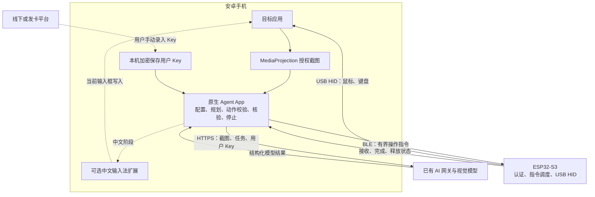

# 安卓 App + ESP32-S3 开发方案

日期：2026-10-20。版本：0.2。状态：可按里程碑开工的设计基线，尚未实现或完成安卓真机验收。

配套文件：[蓝牙协议与模块接口](android-agent-protocol.md)、[开发任务与验收矩阵](android-agent-implementation-checklist.md)。

已确认决策：不使用无障碍；BLE 控制、USB HID 执行；手机直接截图和调用网关；用户手动填写 Key；中文采用同 APK 内可选输入法、用户手动启用；不设手机品牌/型号白名单；当前没有安卓真机。

## 1. 产品目标与范围

参考 `esp32-iphone-agent` 当前版的“手机 App 运行 Agent、ESP32 执行硬件输入”架构，开发原生安卓版本。运行时只需要一台安卓手机、一块 ESP32-S3、手机蓝牙、可上网的 Wi-Fi 或蜂窝网络和可用的视觉模型 Key，不需要电脑运行 Agent，不新增账号、支付或订阅服务端。根据后续讨论，首版控制通道改为 BLE，不要求板子连接 Wi-Fi。

用户通过线下、发卡平台等方式取得 Key，在 App 填入。现有 AI 网关负责 Key 有效期、额度和模型访问权限；App 只作为调用客户端。网关会接收图片、提示词和模型回复。所谓“无需服务端”仅指无需另建本项目的业务服务端，不表示模型离线运行。

主要参考来源是 `esp32-iphone-agent`；不将 `esp32-android-agent` 的电脑端 Python/ADB 服务作为运行依赖。Jev 仅参考消息分析、候选与用户确认等业务思路。

工程基础版先完成可验证的通用 Agent 闭环；中文微信业务在此基础上实现，不能以 ASCII 演示代替中文回复交付。

ESP32 在本方案中的作用是外置输入执行器，不负责截图、推理或模型计费。截图授权本身不授予 App 操作其他应用的权限，因此由板子作为 USB 鼠标和键盘产生输入。用户已明确不接受无障碍服务，本方案不提供无障碍执行、读取聊天或输入回填路线，也不在 HID 失败时切换为无障碍。硬件输入不保证所有页面、机型或第三方应用都接受操作，也不代表不会被识别或限制。

硬性约束：APK 不声明 `AccessibilityService` 或 `BIND_ACCESSIBILITY_SERVICE`，不引导用户开启无障碍，不使用无障碍树采集、`dispatchGesture` 或无障碍 `ACTION_SET_TEXT`。截图仅通过用户主动授权的 MediaProjection；点击、滑动和按键通过 ESP32 USB HID，不依赖 ADB、Root 或电脑运行服务。

## 2. 系统架构

### 蓝牙控制与联网基线

- App 通过手机正常 Wi-Fi 或蜂窝网络调用网关，通过 BLE 控制板子。无需同一路由器、ESP32 热点或 Wi-Fi 配网，也不依赖 ADB。
- App 作为 BLE Central，主动连接 ESP32-S3 的 GATT Peripheral；继承上游命令/回执/状态的分工并升级协议。这里的 BLE 是 App 与板子之间的指令链路，板子对手机的实际操作仍通过 USB HID 完成。
- App 与被控目标应用在同一台安卓手机上。App 经用户授权直接获取屏幕画面，因此 BLE 不传截图或视频，只传操作指令、回执和心跳。截图仍由 App 通过互联网发到模型网关。
- 安卓固件目标不启动 AirPlay、视频回传及 Wi-Fi。Wi-Fi 控制作为有实际需求时再增加的可选通道，不进入首版依赖。
- 按安卓版本实现蓝牙扫描/连接权限与用户授权；Android 12 及以上处理附近设备相关权限，较旧版本按系统要求处理扫描权限。拒绝权限时给出明确状态，不伪装连接成功。
- 运行时不依赖电脑；开发、构建和初次烧录可在 Windows 完成。

## 3. 技术方案与模块

安卓采用 Kotlin、Jetpack Compose、协程、OkHttp 和 Android Keystore。初始开发基线为 Android 11 及以上，不按品牌、型号设置白名单；通过系统 API 版本及 BLE、OTG、录屏和输入法能力自检适配。目标 SDK 按实施时的发行要求选择，Gradle、AGP、Kotlin 和依赖版本固定并验证。不设型号白名单不等于已经验证所有手机；当前没有安卓真机，模拟器与协议模拟可先行，实物兼容证据后补。

| 模块 | 职责 | 主要交付 |
|---|---|---|
| `ui` | 设置、设备绑定、校准、任务、运行状态与停止 | 中文界面；主流程只填写用户 Key |
| `capture` | MediaProjection、ImageReader、截图压缩、尺寸与方向 | 携带帧编号、单调时钟时间、尺寸、方向的截图对象 |
| `model` | OpenAI 兼容视觉请求、严格响应解析、错误分类 | HTTPS 直连；开发配置支持 base URL、模型和 Key |
| `agent` | 规划、观察、决策、执行、核验与预算 | 单任务状态机；每次一个改变界面的动作 |
| `device` | BLE 扫描、绑定、连接、身份验证、心跳与状态 | 手机与板子的一对一控制会话 |
| `control` | 动作验证、串行执行、坐标转换、停止与校准 | 只向 ESP32 发送已声明且经过验证的能力 |
| `storage` | 配置、校准、有限任务记录 | Key 加密保存；默认不保存截图与完整聊天 |
| `ime`（中文阶段） | 可选中文输入 | 用户主动启用、选择输入法后，对当前输入框提交文字 |
| 固件 | BLE GATT 控制、会话、可中断动作、USB HID | 无 AirPlay、Wi-Fi 和视频传输依赖的安卓固件目标 |

发布配置预置网关地址和模型名，用户仅输入 Key。开发构建保留高级配置，便于测试不同兼容接口。实际网关地址、模型名和错误格式尚未提供，使用可替换配置和假接口开发，不把占位地址描述成已接通。

## 4. 从 iPhone 项目保留与改造什么

保留或移植：USB HID 基础实现、相对鼠标与校准思路、规划和执行角色分工、截图反馈、任务记录和模型客户端设计。Swift 实现作为逻辑参考，用 Kotlin 重写，不尝试把 iOS App 直接编译成 APK。

替换或移除：AirPlay 接收、H.264 经 BLE 回传、iOS 生命周期、AssistiveTouch 假设、灵动岛及小组件、Spotlight 与 iOS 专用提示词。

必须改进的已知问题：

1. 现有固件动作同步执行，长移动可能阻塞停止。改为短周期非阻塞动作状态机。
2. 原命令请求 ID 没有完整去重语义。新增会话、命令序号与结果查询，未知结果不得盲目重发。
3. 原 BLE 控制写入没有充分的控制者约束。安卓固件的 HID 写入口必须统一接入新认证及唯一控制会话，不保留绕过认证的旧写入口。
4. 原 App 对“无新视频帧”的宽松推断不适用于新实现。动作前必须验证新截图，旋转或尺寸变化立即作废旧坐标。
5. iOS Home/Back、鼠标加速度和校准参数不能直接沿用到安卓，未实测能力不得向模型宣告。

## 5. 安卓截图与 Agent 生命周期

- 用户主动同意屏幕捕获，通过符合目标系统要求的 `mediaProjection` 前台服务运行，并保留系统通知和停止入口；不设计静默开启录屏。
- 各 Android 版本遵循对应的授权和令牌使用规则；投影停止后重新请求授权，不把旧令牌当永久权限。
- 首版以用户授权的完整屏幕采集为基线。目标应用保持前台，Agent App 转入后台；先确认目标画面，再开始执行。
- 受保护内容、黑屏、锁屏、捕获失效、方向切换及后台服务被终止时暂停或停止，释放输入。安卓各版本及厂商行为需要实测。
- 截图按需提供给模型，不持续上传录屏。图像缩放保留完整坐标映射，隐藏或避开本 App 的悬浮界面；首版优先系统通知控制，不强制悬浮窗权限。
- 用户授权完整屏幕不等于已限制目标应用。若增加“只操作指定 App”，必须使用可靠页面/身份校验；仅凭图片无法保证严格系统级隔离，需如实展示边界。

Agent 状态建议为：`idle → planning → observing → deciding → executing → verifying`，另有 `paused / completed / failed / stopped`。

单步规则：新截图 → 必要时规划 → 模型选择一个动作 → 取消及预算检查 → 新截图与目标状态核验 → 串行执行 → 新截图核验。模型返回 `done` 时仍独立检查目标，不能直接把模型声明当作成功。

默认只启用单任务和单控制者。设置最大动作数、任务时间、连续失败和调用预算。模型请求失败、拒答、截断、非法动作、参数越界均不得执行。

## 6. 固件连接与控制协议

控制采用版本化消息，使用 BLE GATT 命令写入、回执通知和状态通知。要求控制特征启用链路加密，并使用设备专属配对凭证建立双向认证的唯一控制会话；仅开启 bonding 或 Just Works 不等于完成设备身份验证。生产凭证通过受信任的设备二维码交付，开发阶段可通过原生 USB 配置获得。凭证生成、重置和恢复纳入设备交付流程，App 中与模型 Key 分开保存。

复用现有 BLE GATT 布局思路，但安卓固件使用独立服务 UUID、协议版本和能力，避免旧客户端误控。使用标准 HMAC-SHA256 完成预共享设备凭证的双向握手，HKDF 派生会话密钥；控制消息采用标准 AES-GCM 认证加密，绑定方向、会话和递增序号。HMAC 本身不加密数据，不能用认证成功冒充隐私保护。所有动作仅接受已授权控制者；细则和可执行契约见配套协议。

BLE 写入按协商后的 MTU 分片，消息有最大长度、组装超时、会话与命令标识；不能假设一个 JSON 请求总能放进一条 GATT 写入。指令串行发送，停止与回执优先，write-with-response 仅代表 GATT 写入完成，不代表 HID 动作执行成功。

消息至少包含：`version / device_id / session_id / command_id / operation / arguments`。模型 Key 永远不下发到板子。

协议区分：

- `hello/capabilities`：身份、版本、USB 状态和已验证动作能力。
- `heartbeat`：会话保活与设备状态。
- `action`：有界动作，返回 `accepted`，完成后返回 `done` 或明确错误。
- `stop`：取消当前动作、清空待执行队列并释放全部键鼠状态。
- `query_result`：查询同一会话中命令的最后状态，不能把查询变成重做动作。

动作参数有严格范围和时长上限。同一会话的重复命令号不重复执行；断线重建会话后不自动重放旧队列。收到 `done` 只表示 HID 输出完成，实际手机状态由 App 截图核验。

App 停止时先撤销任务执行权、取消待发动作和模型请求，再发送设备停止。模型迟到响应不得继续下发输入。健康 BLE 连接下提出“点击停止后 300 ms 内停止输出”的工程验收目标；失联时提出“最后有效心跳后 1.5 s 内停止输出”的目标，均需测量，不能提前作为已实现保证。控制者断开即清理其会话和待执行动作，不依赖所有蓝牙连接都断开才释放。

首版使用相对鼠标和校准，不宣称绝对触摸。模型坐标统一为完整截图的整数 0..1000，经 App 映射到校准后的 HID 计数。分辨率、方向或指针速度变化需要重新校验。

## 7. 中文与微信业务

### 工程基础版

先完成点按、滑动、长按、滚动、ASCII 输入、停止，以及经过该机型验证的导航动作。通过本 App 测试画布和文本框验证，避免从高风险真实业务起步。

### 中文回复版

普通 HID 键盘不能直接输入任意中文。已获用户确认：在 APK 中提供可选 IME 扩展，用户明确启用并选择后使用 `InputConnection.commitText` 写入当前输入框，随后核验文本。App 不得静默开启输入法，也不提供可被其他 App 任意调用的无鉴权文本注入入口。

IME 是输入法能力，不是无障碍服务；用户已接受这一能力，但实际输入仍须通过验证。IME 未启用、未选中、没有当前编辑连接或输入对象不明确时拒绝提交中文。仅基础控制阶段只声明 ASCII 输入能力，禁止用无障碍回填来替代未完成的中文输入。

该模式明确为“ESP32 完成指针/按键操作、输入法完成中文文本提交”，不是全部输入都经过 ESP32。纯 HID 拼音输入不进入首版主线。

物理键盘可能使软键盘面板隐藏。IME 通过 `onStartInput/onFinishInput/onUnbindInput` 维护编辑会话，不能以面板显示为唯一就绪条件。每次提交绑定当前编辑会话、包名、焦点和最新画面；包名只能识别应用，不能识别聊天联系人。`commitText` 成功也不代表消息已发送，读回或截图无法核实时停在待确认。

### 微信第一阶段

- 用户手动打开指定一对一聊天，仅处理屏幕可见文字。
- 识别联系人和消息方向，区分历史内容与本轮新消息，提供有限去重；同一句重复发送不能被简单文本去重误删。
- 模型分析意图并生成候选，用户确认后填入；首版由用户手动发送。
- 身份不确定、页面切换、弹窗、语音/图片/文件或输入框内容不一致时暂停，不猜测后继续。
- 来信属于不可信数据，不能改变设备权限、目标联系人或允许动作。

后续自动发送只在指定联系人、限定内容和明确开关下实现，增加发送前复核、发送后核验及避免重复发送的状态记录。不得将长时间后台订阅微信消息作为截图方案已具备的能力。

## 8. Key、隐私与发布

- 用户 Key 使用 Android Keystore 保护的密钥加密落盘，明文不进入日志、备份、截图或任务导出。
- App 只保存用户调用 Key，不包含网关管理密钥。正式模型请求走 HTTPS，敏感凭证不随跨域重定向发送。
- 不在 App 实现到期授权判断作为计费依据；网关是额度和有效期的执行方。401、403、429、超时和网关自定义余额不足错误分别展示，具体错误码接入时确认。
- 首版不强制账号登录，不开发支付、发卡和订阅后台。是否查询余额/到期日取决于网关接口，不能用模拟余额冒充真实数据。
- 默认不保存截图或完整聊天。任务日志保留必要动作、结果、耗时和错误，用户可清理；调试导出需脱敏。
- 首版交付签名 APK、受支持板型固件和安装/恢复说明，不承诺商店审核结果。安装、录屏授权、网络绑定和可选输入法均由用户明确操作。
- 发布前核对代码及依赖许可证。原固件 AirPlay 源码含 GPL；安卓构建应隔离不用的组件，按实际编译和分发内容履行许可，不把整个上游统称为 MIT。

## 9. 开发里程碑与完成标准

| 阶段 | 工作与产物 | 放行标准 |
|---|---|---|
| M0：设计与开发基线 | 冻结动作协议、模块接口、用户流程；搭建模拟环境；记录 S3 芯片/Flash/PSRAM/USB；保留旧固件备份 | 不设品牌白名单；系统能力要求、测试页面和恢复流程明确；真机缺失如实记录 |
| M1：手机截图与模型 | 可安装 APK、Key 设置、授权捕获、压缩截图、假模型与兼容模型客户端 | 用户主动授权才能捕获；截图方向正确；错误可见；Key 不泄漏；真接口在提供配置后验证 |
| M2：BLE 硬件手控 | 独立安卓固件目标、蓝牙扫描/绑定、认证连接、可中断动作、校准和 App 内手动测试页 | 真机点击/滑动/ASCII 通过；停止、拔线、蓝牙断开、重复命令不产生旧动作或重复输入 |
| M3：通用 Agent 闭环 | 手机端单步决策、执行后核验、预算和人工接管 | 从明确起点完成设置页导航、测试画布点按、ASCII 填写；每步有截图依据，伪完成会被拒绝 |
| M4：中文和聊天辅助 | 用户启用的 IME、指定聊天识别、候选与确认填入 | 中文实际写入并核验；无焦点/切错聊天不提交；正常流程不自动发送 |
| M5：试用交付 | 签名 APK、固件、蓝牙绑定、安装与恢复说明、实机报告 | 全流程无需电脑运行；本地记录可清理；蓝牙、互联网、权限与重启恢复边界明确 |
| M6：受限自动回复（后续） | 联系人范围、发送规则、发送前后核验、重复消息状态 | 单独验收误发、重发、页面切换和长时间运行，不以基础 Agent 演示代替 |

按以上依赖推进，M2 的固件和协议模拟与 M1 的客户端工作可以独立进行，M3 可先用假设备验证状态机；正式放行 M3 必须等截图与硬件两条实机链路都过关。中文输入已选可选 IME。当前无安卓真机不阻碍开发，但 M2/M3/M4/M5 的相应实机门槛不能用模拟结果代替。具体工期由下方配套任务和实际验证进度估算，不用尚未验证的假设承诺交付日期。

## 10. 验证策略

1. 单元与模拟：模型响应解析、动作范围、坐标转换、陈旧截图拒绝、状态机、预算、取消、命令去重与异常恢复。使用假模型和假设备，不调用付费接口。
2. Android 仪器测试：MediaProjection 授权/撤销、截图方向、前后台切换、屏幕关闭、进程终止、Key 存储与日志脱敏。检查构建后的 manifest 和权限说明，不含无障碍服务或其绑定权限；不开启系统无障碍即可完成全部首版用例。系统权限界面需要真机或对应系统环境确认。
3. 固件构建与协议测试：实际目标板配置可编译；BLE 权限、MTU 分片、恶意/畸形/超长消息、认证失败、第二客户端、重复 ID、超时、长动作中停止与掉电恢复；确认 Wi-Fi/AirPlay/视频通道未启动。
4. 实机联调：记录手机型号、Android 版本、ESP32 板型、固件版本、网络、模型和起始页面。编译成功或模拟通过不代表手机输入验证通过。
5. 首套设备至少各重复执行基础点按、滑动、ASCII、停止与断线用例，记录次数、失败及耗时；中文及微信用单独用例报告。先收集真实基线再确定成功率指标，不预报任意机型表现。

## 11. 开发目录与当前状态

建议后续在新的 `android-phone-agent/` 目录开发，包含 `android/`、`firmware/`、`protocol/`、`docs/`，保留上游来源和许可。现有 iPhone 检出和原始 Flash 备份保留作为参考与恢复材料，不直接覆盖。

本次仅交付开发方案与实施契约，尚未创建安卓工程、编译 APK、改固件或刷写板子，也未调用付费模型。已有板卡识别和 iPhone 固件测试不能作为本方案的安卓兼容证据。当前用户暂无安卓真机，后续构建与模拟报告必须把实机待验收项单独列出。

## 12. 用户流程与界面

1. 安装 APK，首页展示蓝牙、板子、录屏、模型与输入法的真实就绪状态，不设注册登录。
2. 在设置填写用户 Key；发布版预置网关与模型，开发版可使用高级设置。连通测试只使用合成图，可能有少量模型费用，界面明确提示。
3. 扫描或通过开发期 USB 交付获取板子的独立绑定凭证，授权附近设备并连接；验证 USB 已连接和控制协议版本。
4. 中文用户按系统流程手动启用、选择本 App 输入法；普通点击任务不强制启用输入法。
5. 在本 App 校准页用真实鼠标点击事件采样和验证；不依赖投屏一定能显示鼠标光标。
6. 输入任务，用户授权录屏；明确选择捕获范围。跨应用任务需要完整屏幕画面，单应用共享不具备同等观察范围。
7. 用户切到目标应用，确认就绪后执行。未启用测试/校准模式时，不让 Agent 操作自身的 Key/设备设置界面。
8. 运行时通知提供暂停和停止；主动手动接管先暂停任务。没有无障碍时，App 不能保证捕获其他应用中的每一次人工触摸，不宣称自动识别所有人工接管。
9. 用户返回 App 查看结果、候选和记录。返回本 App 期间暂停自动输入；恢复先重新观察，不继续旧坐标。

首页、设备、模型设置、任务/记录、校准/测试和输入法引导即可覆盖首版。默认不申请悬浮窗、通知读取或使用情况访问；截图功能和设备连接按系统要求申请相应权限。通知权限被拒绝时说明可用的 App/系统停止方式，不静默启动无人值守模式。

## 13. 权限、截图与恢复细则

- 录屏流程：可见 Activity 发起系统授权 → 收到同意 → 启动并提升 `mediaProjection` 前台服务 → 获取 MediaProjection → 注册停止回调 → 建立 VirtualDisplay。按 target SDK 声明相应前台服务类型与权限。
- Android 14+ 每次投影会话重新同意；不重复消费旧授权 Intent，也不为同一个投影对象重复创建 VirtualDisplay。已有会话可持续获取多帧；旋转通过调整显示和 Surface 处理，同时作废旧动作。
- 单应用共享不一定捕获系统导航、输入法和其他窗口。用户选择的范围不够时不继续跨应用操作；不能以选择单应用录屏推导出 USB HID 被系统限制在该应用内。
- 图像对象必须关闭并有界排队，使用 `acquireLatestImage` 等机制丢弃积压。记录投影代际、帧编号、接收单调时间、尺寸和方向；来源图像时间戳仅在验证时间基准后用于计算采集年龄，不能直接当成 App 时钟。
- 没有新帧不自动等于画面未变。模型返回后检查观察代际与时效；动作前取当前可验证画面，动作后等新帧。始终无法得到新观察时进入 `NO_FRESH_FRAME` 并暂停，相关阈值由实测定稿。
- 投影 `onStop`、锁屏、进程死亡、USB 异常、蓝牙断开或权限撤销均撤销执行权。恢复后重新授权/认证/校验校准并重新观察；不自启动录屏，不从开机广播偷偷恢复任务。
- Android 12+ 分别处理 `BLUETOOTH_SCAN/BLUETOOTH_CONNECT`；仅作 central 不额外申请广播权限。Android 11 扫描按平台要求处理定位；首次发现只在用户可见界面进行，后台扫描不是默认依赖。

## 14. 当前确定与尚待接入的事项

| 事项 | 状态与处理 |
|---|---|
| 无障碍、ADB、Root、电脑运行服务 | 明确不采用 |
| 中文输入路线 | 用户已接受同 APK 内可选 IME；必须由用户手动启用选择 |
| 手机型号范围 | 不设品牌型号白名单；以系统能力检测和系统版本适配 |
| 安卓测试设备 | 暂无；先构建和模拟，不能宣称真机通过 |
| 网关地址、模型、错误格式 | 实现时通过可替换发布配置接入；不开发网关后端 |
| 用户 Key | 用户自行取得并填写；不写入源码和固件 |
| 发卡、收款、自动续费、账号系统 | 不在本项目范围 |
| 自动发送微信 | 作为 M6 单独放行；不与候选/草稿填入混为同一验收 |
| 常驻监测 | 仅限授权截图仍在运行且目标画面可见；不是微信后台消息接口 |

## 15. 平台依据与源码定位

Android 平台约束依据：[MediaProjection 指南](https://developer.android.com/media/grow/media-projection)、[录屏前台服务](https://developer.android.com/develop/background-work/services/fgs/service-types#media-projection)、[BLE 权限](https://developer.android.com/develop/connectivity/bluetooth/bt-permissions)、[输入法开发](https://developer.android.com/develop/ui/views/touch-and-input/creating-input-method)、[InputConnection](https://developer.android.com/reference/android/view/inputmethod/InputConnection)。文档要求仍需在所选 SDK 与系统镜像验证。

- `esp32-iphone-agent/README.zh-CN.md`：新版 App 本机运行 Agent，ESP32 AirPlay/BLE/USB 数据流。
- `esp32-iphone-agent/ios/IPhoneAgent/Agent/AgentLoop.swift`：规划、执行、反馈与动作接口。
- `esp32-iphone-agent/ios/IPhoneAgent/Agent/Pointer.swift`：指针与键盘实现。
- `esp32-iphone-agent/ios/IPhoneAgent/App/TouchCalibration.swift`：App 内校准探针思路。
- `esp32-iphone-agent/ios/IPhoneAgent/Services/LLMClient.swift`：OpenAI 兼容模型请求。
- `esp32-iphone-agent/hardware/hid_bridge/hid_bridge.ino`：USB HID、当前命令入口及同步执行方式。
- `esp32-iphone-agent/hardware/hid_bridge/ble_link.cpp`：BLE 队列和访问控制现状。
- `esp32-iphone-agent/hardware/hid_bridge/netcfg.cpp`：配网、AP/STA 与 NVS。
